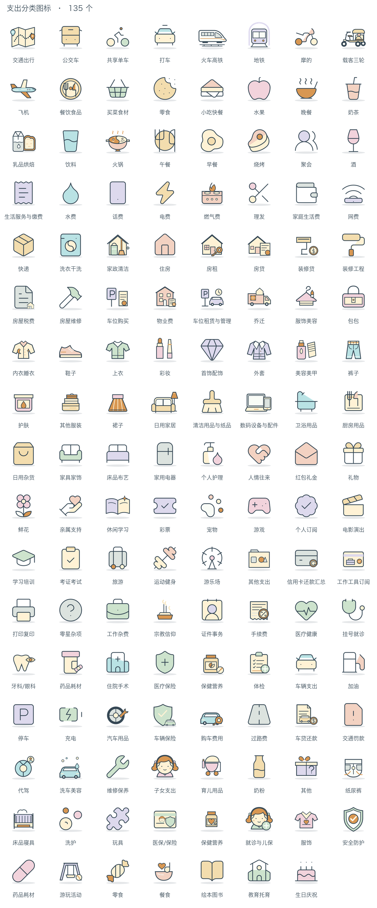
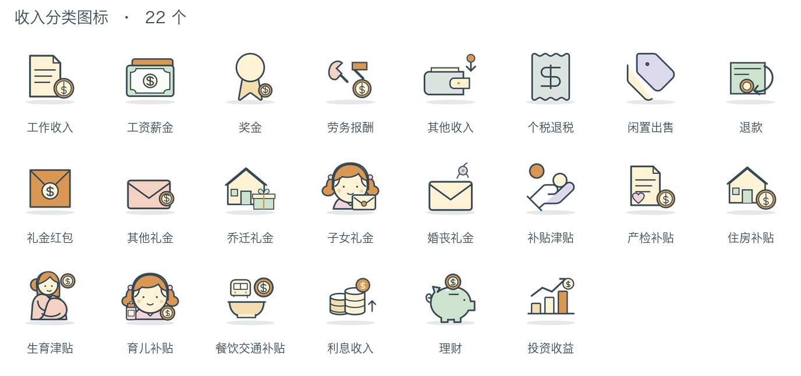

# Personal Finance Category Icons

个人记账使用的收入与支出分类图标。分类名称和资产路径见 `分类清单.csv`。

每个一级、二级分类适合记录的账单示例见 [分类使用说明](分类使用说明.md)。

- 支出：12 个一级分类、123 个二级分类。
- 收入：4 个一级分类、18 个二级分类。
- 每个图标同时提供 SVG 和 512 × 512 透明背景 PNG。
- 素材统一放在 `素材/`：`01-支出`、`02-收入`、`03-支出页面素材`、`04-功能页面背景`、`05-帐本封面`；图标按一级分类、二级分类存放，文件名中的 `/` 改为 `_`。
- 分类名称使用可复用的通用叫法；车辆与子女支出分别列为独立分类。
- 带儿童肖像的 5 个分类同时提供 `(女)`、`(男)` 两套 SVG/PNG；`分类清单.csv` 默认指向女版，男版见 `预览-子女变体.png`。
- 采用透明背景、深色粗描边、奶油色辅色、橙色强调与底部阴影的物件插画风格。一级分类在浅青、暖黄、鼠尾草绿、柔粉、蜜桃和浅紫灰之间分配主色；二级分类从同一套低饱和配色中按物件含义选择颜色。
- `日用家居`、`安全防护`、`乳品烘焙` 三张参考图的造型用于对应分类，颜色按分类配色统一。
- 部分基础造型改绘自 Lucide，相关许可见 `Lucide-LICENSE.txt`。
- 新增、调整与删除记录按日期保存在 [docs/changes/](docs/changes/)（每天一份）；造型调整对照预览见 `调整预览.png`。
- 修改分类配色后，运行 `python3 scripts/apply_palette.py` 同步 PNG 与预览图（需要 Pillow 和 `rsvg-convert`）。
