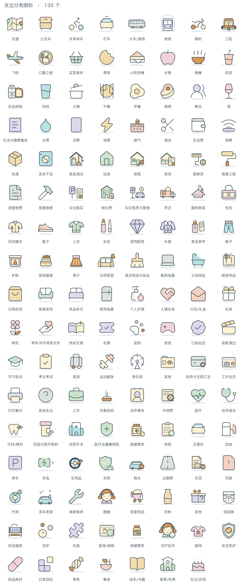
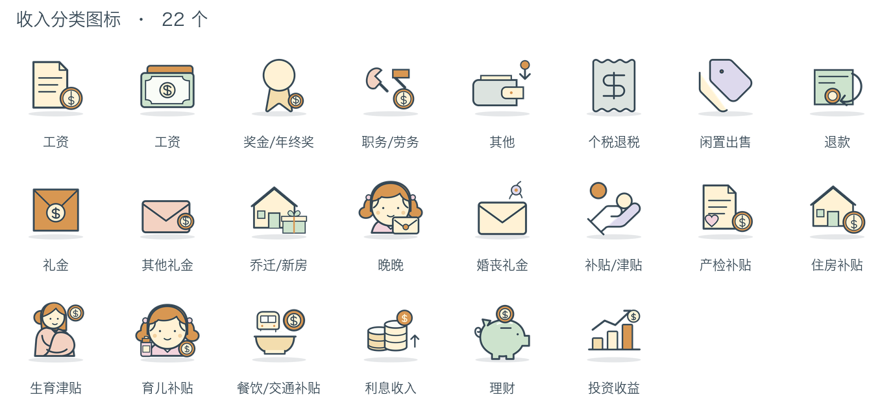

# Personal Finance Category Icons

个人记账使用的收入与支出分类图标。分类名称和资产路径见 `分类清单.csv`。

- 支出：12 个一级分类、123 个二级分类。
- 收入：4 个一级分类、18 个二级分类。
- 每个图标同时提供 SVG 和 512 × 512 透明背景 PNG。
- 图标按 `收入/支出 → 一级分类/二级分类` 存放；文件名中的 `/` 改为 `_`。
- `汉堡包` 是汽车相关支出的自定义分类名。
- 采用透明背景、深色粗描边、奶油色辅色、橙色强调与底部阴影的物件插画风格。一级分类在浅青、暖黄、鼠尾草绿、柔粉、蜜桃和浅紫灰之间分配主色；二级分类从同一套低饱和配色中按物件含义选择颜色。
- `日用家居`、`安全防护`、`乳品烘焙` 三张参考图的造型用于对应分类，颜色按分类配色统一。
- 部分基础造型改绘自 Lucide，相关许可见 `Lucide-LICENSE.txt`。
- 调整历史见 [CHANGELOG.md](CHANGELOG.md)，逐项清单保存在 [docs/changes/](docs/changes/)；造型调整对照预览见 `调整预览.png`。
- 修改分类配色后，运行 `python3 scripts/apply_palette.py` 同步 PNG 与预览图（需要 Pillow 和 `rsvg-convert`）。
